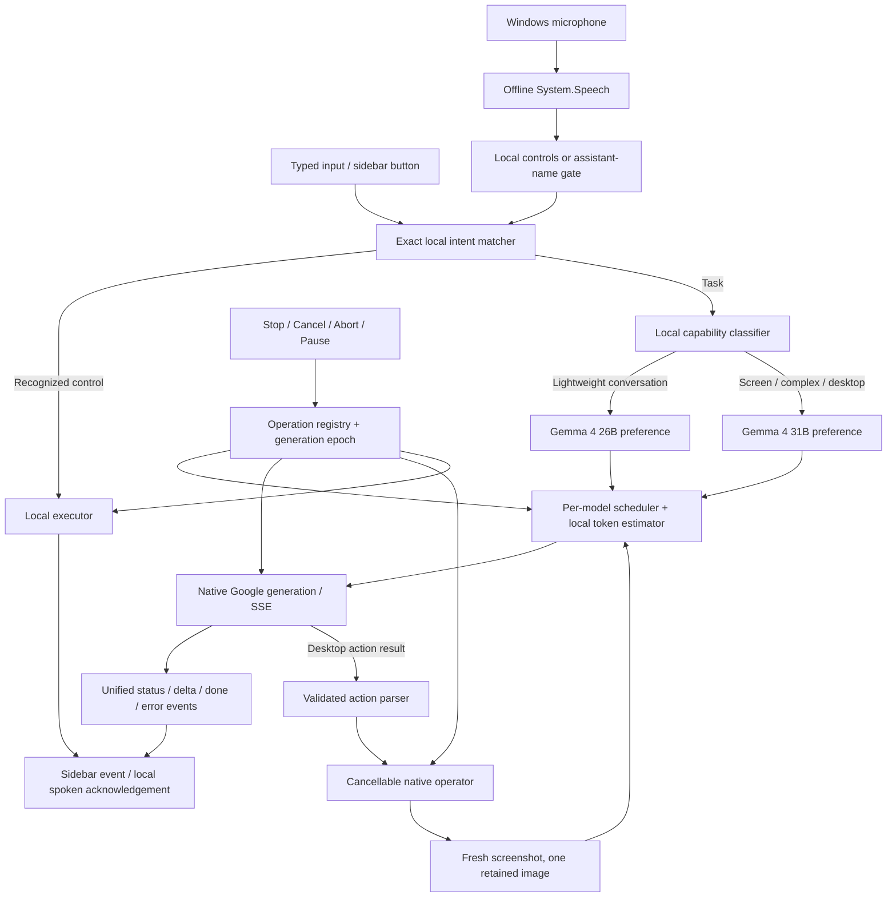

# Local-first assistant architecture

## Boundaries

The Electron main process owns credentials, request routing, cancellation, native speech, disk writes, and model scheduling. The renderer owns presentation, bounded chat history, and MediaRecorder. A typed preload API carries events and commands; the assistant handlers check the owning web contents and main frame.

## Source map

| Layer            | Files                                                                        | Responsibility                                                               |
| ---------------- | ---------------------------------------------------------------------------- | ---------------------------------------------------------------------------- |
| Pure routing     | `main/shared/assistant.ts`                                                   | Exact local commands and a deterministic capability heuristic                |
| Orchestration    | `main/services/assistant.ts`                                                 | Local-first dispatch, task ownership, streaming events, bounded history      |
| Cancellation     | `main/services/operations.ts`                                                | Abort controllers, deadlines, cancellation-aware native waits                |
| Offline speech   | `main/services/localSpeech.ts`, `windowsSpeechScript.ts`                     | Hidden Windows speech process, grammar/dictation, wake gate, local synthesis |
| Local capture    | `main/services/localMedia.ts`                                                | Screenshot persistence, recording chunk writes, safe artifact IDs            |
| Model scheduler  | `sdk/src/googleQuota.ts`                                                     | Fair queue, independent rolling budgets, local estimates, SSE                |
| Model routing    | `sdk/src/googleRouting.ts`                                                   | Preferred capability, queue-aware selection, bounded failover                |
| Desktop workflow | `main/services/runAgent.ts`, `main/agent/operator.ts`, `sdk/src/GUIAgent.ts` | Screenshot/action loop, cancellation checkpoints, bounded context            |
| Sidebar          | `renderer/.../AssistantPanel.tsx`, `assistant.css`, `useRecording.ts`        | Conversation, captures, settings, media lifecycle                            |
| IPC contract     | `preload/index.ts`, `main/shared/assistant.ts`                               | Request and event types, specific assistant methods                          |

Paths beginning with `main/` and `renderer/` are under `apps/ui-tars/src/`; SDK paths are under `packages/ui-tars/`.

## Voice and local command execution

Windows speech recognition runs in a hidden PowerShell/.NET process after the user enables the microphone. System.Speech grammar prioritizes the known controls; dictation supplies general requests. It uses the default microphone and an installed recognizer, preferring an English language pack when available.

Recognized text first goes to the same exact matcher as typed input. Commands do not need an API key and are checked before the active-request guard. This lets Stop interrupt a busy model. A name-only wake arms the next utterance for 12 seconds; general spoken tasks otherwise need the assistant name. Matching is bounded and deterministic, with no classifier model.

“Stop screen recording” is a recording command, whereas “Stop” cancels all work. Quoted or embedded instructions such as “Explain stop signs” do not accidentally trigger controls. Compound requests such as taking and explaining a screenshot are tasks, rather than silently discarding half the request.

Health checks and time queries use local logic and optional OS speech. Live microphone audio never enters the Google Live API. Uploaded audio is an explicitly selected cloud transcription operation, followed by editable text and the same local router on Send.

The speech process reports readiness, failure, and disconnects. Turning voice off, closing the panel, renderer failure, and app shutdown stop it. There is no silent cloud fallback. Local voice currently supports Windows only; this limitation is visible in Settings and setup documentation.

## Cancellation model

Every new request/capture/upload gets an AbortController and deadline. Stop:

1. Advances a generation epoch and clears the active request ID.
2. Aborts registry operations and the GUI agent signal.
3. Interrupts speech output and tells the renderer to stop MediaRecorder and tracks.
4. Emits a terminal UI event without waiting for a slow native API.
5. Rejects late chunks, screenshot results, status updates, and completion callbacks from the cancelled epoch.

The scheduler removes cancelled queue tickets. Network fetch and stream readers share the signal. Native screenshot APIs that lack cancellation are raced against the signal; their late results are discarded before model invocation or persistence. Screenshot file-write failures clean partial output.

The native input adapter checks cancellation before/after pointer movement and before clicks, key presses, paste, scrolling, and drag stages. Held keys/buttons are released in cleanup. A native input already dispatched to the OS cannot be undone; the implementation prevents subsequent steps rather than promising reversal.

Pause is intentionally a terminal pause: cancel the current operation, preserve conversation, wait for a new user request. This avoids the old unresolved resume-promise state. The SDK also makes repeated pause idempotent and resolves a paused agent when stopped.

## Model routing and balancing

- **26B:** short conversations and ordinary questions.
- **31B:** images, screen content, explicit desktop control, long inputs, codebase/architecture/debugging and similar technical requests.
- UI mode can explicitly choose conversation, desktop actions, or screen analysis.
- Both hosted Gemma models accept image input, enabling a visible fallback for screen requests when necessary.
- The preference is preserved unless the alternate model materially reduces a queue or the preferred model has a retryable failure.
- At most one failover on 429/500/502/503/504, only before any response text is delivered.
- No failover for invalid credentials, denied access, invalid payloads, partial responses, or already-executed native actions.

This is capability-aware load balancing, not blind round-robin that sends every second complex task to a smaller model. The selected model and reason are emitted to the sidebar, with one response contract for both.

## Quota accounting

Each API key/model pair has a separate process-local queue and rolling 60-second counters. The configured guard is 30 RPM and 16,000 tokens. First dispatch is immediate; consecutive starts within one second are paced. Quota exhaustion and server cooldowns can wait longer.

There are no network token-count or connection-test preflights. A conservative text/media estimate plus bounded output allowance reserves capacity; actual usage metadata replaces the reservation on completion. Unknown/failed usage retains its estimate. In-flight reservations remain held beyond a minute until settled. Counts are otherwise attributed to dispatch time.

The estimator is a heuristic, not an exact tokenizer. Google's project-level quotas remain authoritative. Separate keys/processes or external clients are not coordinated; a restart resets these counters. Retry-After and transient failures feed cooldowns. Server 429 remains a supported recovery path.

## Context, screenshots, and storage

- Chat context: at most six recent messages, each capped to 1,800 characters; request input capped to 16,000 characters.
- GUI context: task plus a bounded recent action window, only the current screenshot sent to the model.
- Output allowance: 768 tokens for fast chat/GUI planning; up to 2,048 for deep conversation.
- Images already preprocessed in a task use a two-entry in-memory cache.
- Native screenshots provide dimensions/mime metadata, avoiding the extra full decode in the SDK.
- Capture directly at target resolution; remove the old capture-small/upsample path.
- Only the latest screenshot remains in desktop state; chat storage excludes image/video bytes.
- Screenshots save PNG plus a bounded JPEG preview/analysis copy.
- Recordings use screen-only MediaRecorder, one-second chunks, a serialized disk-write chain, 16 MB renderer backpressure, 512 MB total, and ten-minute duration cap.
- A recording-stop watchdog targets the recording ID that was cancelled, so it cannot stop a later recording.

## UI and startup

A rectangular Electron BrowserWindow docks to the display's right work area. Expand toggles 460/820-pixel widths within the available work area. Native minimize/restore avoids CSS animation state desynchronization. Display changes re-dock the window.

The dark panel has fixed header/composer and one scrollable content region. Conversation, captures, recording, progress, errors, and settings remain inside it. Token updates batch at 60 ms; Markdown is rendered after streaming completes. Autoscroll stops when the user scrolls away. Reduced-motion preferences disable animation.

Model/browser modules and browser discovery are deferred. Development extension installation and startup telemetry calls were removed from startup. The app no longer hides the panel or creates the old task widget during the desktop loop. Renderer errors show a reload action and request cancellation.

## Trust and release scope

The new assistant endpoints accept only the owning renderer's main frame. Capture paths are main-process generated; reveal/analyze operations use known artifact IDs. Renderer navigation cannot replace the app with a remote page, and links open only HTTP(S) in the system browser. The CSP keeps model traffic in the main process.

This is an implemented architecture with automated and local smoke validation, not a claim of certification across hardware/OS combinations. See [PERFORMANCE.md](PERFORMANCE.md) and [ROADMAP.md](ROADMAP.md) for evidence and rollout gates.
