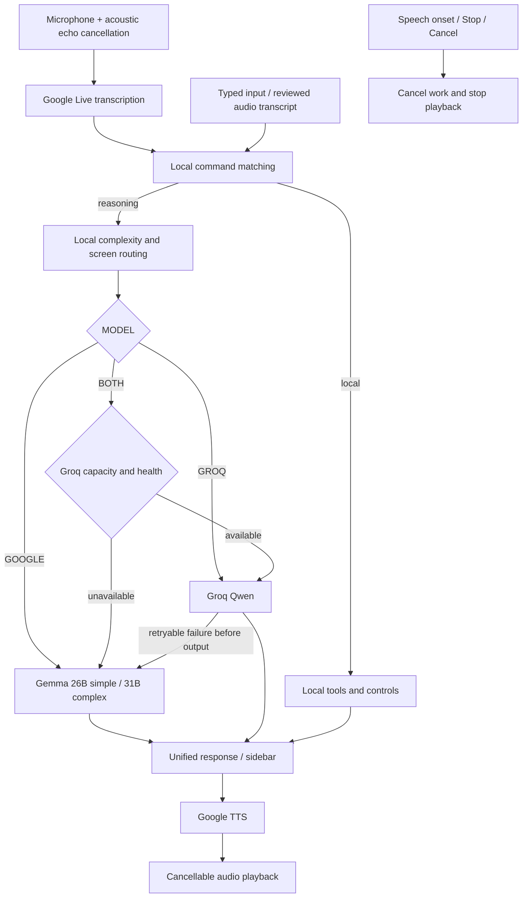

# Assistant architecture

## One text pipeline, Google voice at both ends

The Groq-to-Google failure edge applies only to BOTH. There is no provider crossover in GOOGLE or GROQ mode. Google voice is independent of reasoning provider selection.

## Responsibilities

| Layer                              | Responsibility                                                                                                 |
| ---------------------------------- | -------------------------------------------------------------------------------------------------------------- |
| AssistantPanel / assistant.css     | Conversation, settings, captures, state, responsive docked layout                                              |
| useGoogleVoice                     | Mic permissions, 16 kHz PCM capture, voice meter, speech-onset interruption, decoded audio playback            |
| GoogleVoice main service           | Google transcription WebSocket, wake gate, final text dispatch, reconnect, Google TTS request and cancellation |
| assistant main service             | Trusted IPC owner, authoritative local intent matching, routing, cancellation, local tools                     |
| providers SDK module               | Groq-first selection, native REST/SSE transport, local capacity, fallback/recovery, normalized responses       |
| googleRouting / googleQuota        | Google 26B/31B selection, per-model queues, local estimates, actual usage                                      |
| vision SDK module                  | JSON validation, normalized boxes, target confidence, conversion to one native action                          |
| GUIAgent / native/browser operator | Capture-action-verify loop and cancellable device operations                                                   |
| localMedia                         | Local capture files, bounded previews, recording chunks and file finalization                                  |

## Voice boundaries

Google's dedicated gemini-3.5-transcribe-live emits interim and finalized transcripts. Interim text updates subtitles; exact Stop/Pause can interrupt early. Final text checks local commands before the wake gate. Other requests require the configured name or the 12-second wake window.

Google transcription never provides the reasoning answer. Gemma or Groq does that, and gemini-3.8-flash-lite-tts receives the answer text with speech style metadata. The REST response's WAV audio is decoded in the renderer. No OS speech synthesis or offline recognition is substituted.

Continuous input uses acoustic echo cancellation. Speech onset stops local audio without a network round trip and cancels the active response. Explicit Stop additionally finishes recording and cancels all operations. Audio generation is abortable, and epochs reject late audio after interruption.

Established transcription connections retry at 1/2/4 seconds, up to three attempts; authentication/protocol failures surface directly. No microphone starts automatically at launch.

## Groq vision and automation

1. Capture a screenshot locally.
2. Send the current image plus bounded task/history to Qwen.
3. Require JSON containing a plain-language summary, detected elements, and an optional next action.
4. Validate unique IDs, finite ordered coordinates within 0–1000, text bounds, and confidence values.
5. Analysis returns summary + overlays. Automation resolves each pointer action to a detected element center; confidence below 0.65 or missing targets prevents action.
6. Execute one action through the existing operator.
7. Capture again before choosing another action.

The schema supports click, double/right click, drag, scroll, type, hotkey, wait, finished, and request-user-help. It never evaluates model-generated JavaScript or arbitrary model functions. Model confidence is not a calibrated guarantee; target accuracy must be measured on real applications.

## Capacity, fallback, and context

Groq chat/vision share an aggregate local 30 RPM / 16k TPM bucket. Google models have independent buckets. Counters are process-local, and actual provider organization/project quotas remain authoritative.

BOTH uses Groq until its local capacity is unavailable. It checks locally rather than probing the provider. A retryable error before output can select Google once; output already emitted is never combined with a second answer. Cooldowns expire automatically so future requests recover to Groq.

Text, image, and output budgets use conservative local estimation; usage metadata reconciles completed requests. No preflight token count. No unconditional post-response delay. One-second spacing only applies between nearby dispatches. Context keeps recent bounded text and the current screenshot.

## Cancellation and trust

Main-process operations own AbortControllers and deadlines. Request IDs and epochs prevent stale completions from reviving UI state. Abort is passed through queue waits, REST/SSE, transcription lifecycle, TTS, capture waits, and GUI steps.

Recording stops tracks immediately and flushes existing chunks to disk. Input operations already issued to the OS cannot be undone; cancellation prevents subsequent steps and releases held input state.

New assistant IPC validates the owning renderer/main frame. Provider endpoints are fixed HTTPS/WSS origins. Keys stay in main-process request construction and are never embedded in renderer bundles. Settings are local; conversation history does not retain media bytes. Screenshot text is treated as untrusted task data.

## UI system

A restrained neutral palette, small stable navigation, one composer, consistent typography/spacing, subdued actions, and explicit state labels replace decorative cards and marketing-style empty states. Live voice activity and transcript text sit directly above the composer. Captures show validated boxes without triggering actions. All motion honors reduced-motion preferences.

Remaining deployment gates are listed in [ROADMAP.md](ROADMAP.md).
